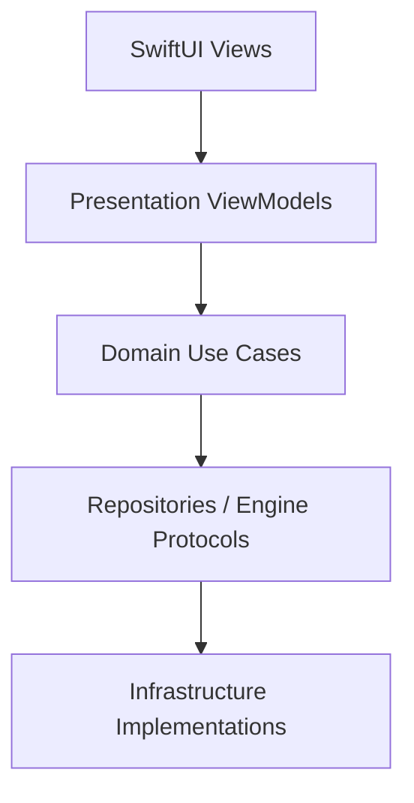

# Swift AI Reference App

A SwiftUI iOS chat app built as a clean-code reference implementation: local-first, clearly layered, and designed to be easily extended with new models, backends, or features.

## Screenshots

| Chat | Conversations | Settings |
| --- | --- | --- |
| _Placeholder - add a chat screen screenshot here._ | _Placeholder - add a conversation list screenshot here._ | _Placeholder - add a settings screen screenshot here._ |

## Highlights

| Area | What is in the app |
| --- | --- |
| Chat | Streaming assistant replies, stop generation, and conflict handling when another chat is already generating |
| Conversations | Create, search, delete, recents ordering, and automatic title generation |
| Settings | System prompt, additional instructions, and response style presets |
| Model runtime | Stub assistant for simulator and tests, plus llama.cpp-backed GGUF inference on device, built behind an engine protocol so it is easy to extend with new models or backends |
| Localization | English, Czech, and Slovak |

## Architecture



- **UI (SwiftUI Views)**: render state and forward actions.
- **VM (Presentation ViewModels)**: manage UI state, navigation, and orchestration.
- **UC (Domain Use Cases)**: models, use cases, and typed errors.
- **REPO (Repositories / Engine Protocols)**: define the contracts between domain logic and infrastructure. The `LLMEngine` protocol keeps room for future remote model providers, and repository protocols keep conversation and message storage swappable.
- **INFRA (Infrastructure Implementations)**: SQLite/file-backed persistence, prompt settings storage, and llama.cpp integration.
- **Vendor**: local llama.cpp package sources live under `Vendor/LlamaBinary`.

## Runtime behavior

- Storage defaults to SQLite.
- Set `SWIFTAIREFERENCEAPP_STORAGE_BACKEND=file` or `filebacked` to use file-backed storage.
- Set `SWIFTAIREFERENCEAPP_STORAGE_ROOT=/path/to/dir` to move the SQLite database or file-backed data into a custom directory.
- The app looks for `model.gguf` in the app bundle, then falls back to the first bundled `.gguf` file; the Xcode target includes a build step that copies a local GGUF into the bundle as `model.gguf`, preferring `model.gguf`, then `llama-3.2-1b-instruct-q8_0.gguf`, then the first `.gguf` file found in the project root.
- Simulator and test runs use `StubLLMEngine`.
- If no model is found or loading fails, the app falls back to the stub engine and shows a startup warning banner.

## Getting started

1. Open `SwiftAIReferenceApp.xcodeproj` in Xcode.
2. Build and run the `SwiftAIReferenceApp` scheme.
3. For on-device inference, keep a GGUF model in the project root or bundle one into the app target.

## Requirements

- Xcode with the iOS SDK
- A macOS development machine that can run the iOS simulator
- A physical iPhone or iPad for real on-device inference
- `Vendor/LlamaBinary` available as a local package dependency in the workspace

## Testing

Unit tests cover:

- domain models and use cases
- file-backed and SQLite persistence
- prompt settings persistence
- presentation logic for chat, conversations, and app shell behavior
- llama.cpp formatting and engine behavior

UI tests cover the launch flow, as well as basic flows such as sending a message, conversation title generation, and conversation persistence.

## Project structure

```text
SwiftAIReferenceApp/
  App/
  Domain/
  Infrastructure/
  Presentation/
  Assets.xcassets/
  en.lproj/
  cs.lproj/
  sk.lproj/
Vendor/
  LlamaBinary/
SwiftAIReferenceAppTests/
SwiftAIReferenceAppUITests/
```
