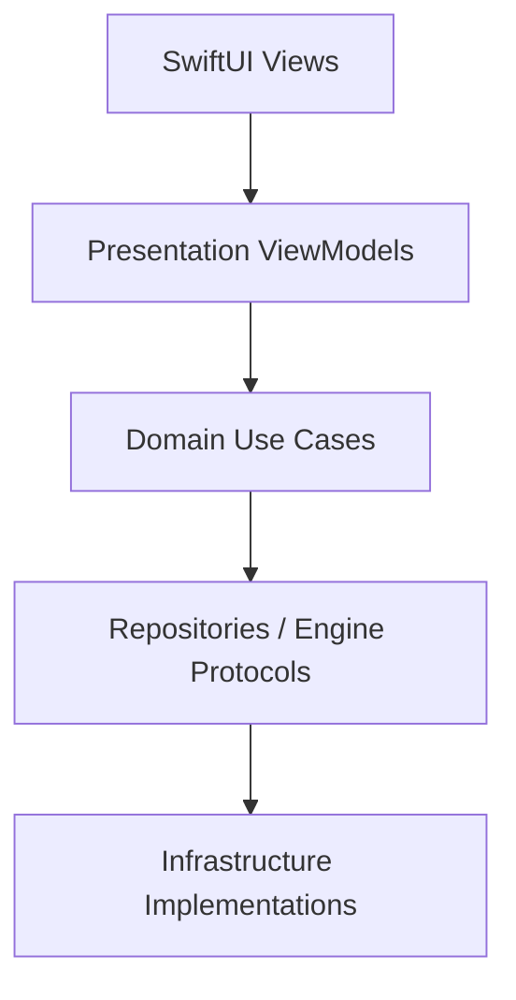

# Swift AI Reference App

A SwiftUI iOS chat app built with structured concurrency and a layered architecture. It is designed as a clean, maintainable reference that can grow into support for API-based cloud LLMs and other backends without reworking the app core.

## What it does

- **LLM backends**
  - Mock and local model implementations are the current status quo
  - The app uses protocol boundaries so API-based cloud LLMs can be added later without changing the UI layer
- **Storage backends**
  - SQLite and file-backed implementations are the current status quo
  - The repository interfaces keep the storage layer easy to expand or replace
- **App features**
  - Chat UI with streaming assistant responses
  - Conversation list, search, delete, and recents sorting
  - Prompt customization in Settings
  - Conversation title generation
  - Stub LLM for simulator and test runs

## Architecture

The code is split into clear layers:



- **Presentation**: SwiftUI views and view models; owns UI state and orchestration.
- **Domain**: models, repository/engine protocols, and use cases.
- **Infrastructure**: SQLite/file-backed repositories, prompt settings persistence, and llama.cpp integration.
- **Vendor**: local llama.cpp package sources live under `Vendor/LlamaBinary`.

## Current storage and model options

- **Storage**
  - `sqlite` (default)
  - `file` / `filebacked` via `SWIFTAIREFERENCEAPP_STORAGE_BACKEND`
- **LLM**
  - `StubLLMEngine` for simulator and tests
  - `LlamaLLMEngine` for on-device GGUF inference on a physical device

## Requirements

- Xcode with the iOS SDK
- A macOS development machine capable of running the iOS simulator
- A physical iPhone or iPad if you want to test real on-device inference
- For real on-device inference, a GGUF model file bundled with the app
- Standard Xcode code signing setup for device builds and installs
- The local `Vendor/LlamaBinary` package dependency available in the workspace

## Getting started

1. Open `SwiftAIReferenceApp.xcodeproj` in Xcode.
2. Make sure the app target is signed in Xcode if you want to run on a physical device.
3. Build and run the `SwiftAIReferenceApp` scheme.
4. For on-device inference, include a GGUF model in the app bundle.

### Model setup

The app looks for:

1. `model.gguf` in the app bundle
2. the first `.gguf` file in the bundle resources

If no model is found, the app shows a warning banner and uses the stub engine. Simulator and test runs also use the stub engine.

### Optional storage backend

Set the environment variable:

```bash
SWIFTAIREFERENCEAPP_STORAGE_BACKEND=file
```

Use `sqlite` to keep the default SQLite-backed storage.

## Testing

Most of the app behavior is covered by unit tests for:

- domain models and use cases
- repositories and SQLite storage
- prompt settings persistence
- chat and conversation presentation logic
- llama.cpp formatting and engine behavior

UI tests are also included for the app shell and launch flow.

For smaller contributions, UI testing is usually not needed, but unit tests are strongly encouraged.

Run tests from Xcode or with `xcodebuild` using the `SwiftAIReferenceApp` scheme.

## Project structure

```text
SwiftAIReferenceApp/
  Domain/
  Infrastructure/
  Presentation/
  Assets.xcassets/
  en.lproj/
  cs.lproj/
  sk.lproj/
Vendor/
  LlamaBinary/
SwiftAIReferenceAppTests/
SwiftAIReferenceAppUITests/
```

## Notes

- The `LLMEngine` protocol keeps room for future remote model providers.
- Conversation and message storage are intentionally swappable behind repository protocols.
- The app is localized for English, Czech, and Slovak.
