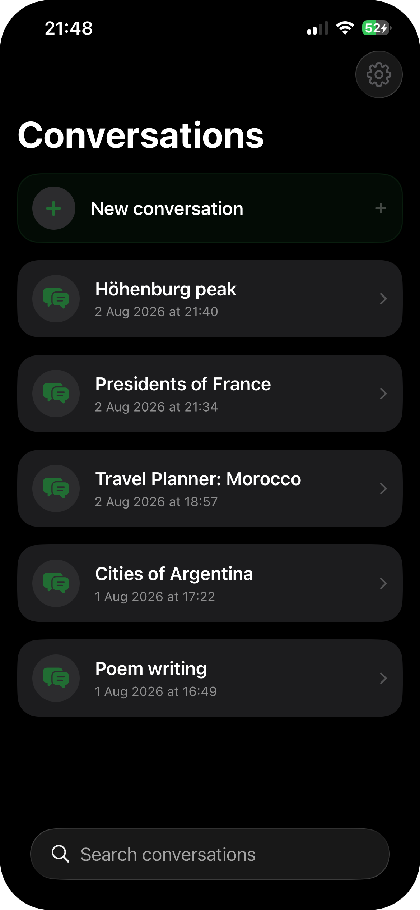
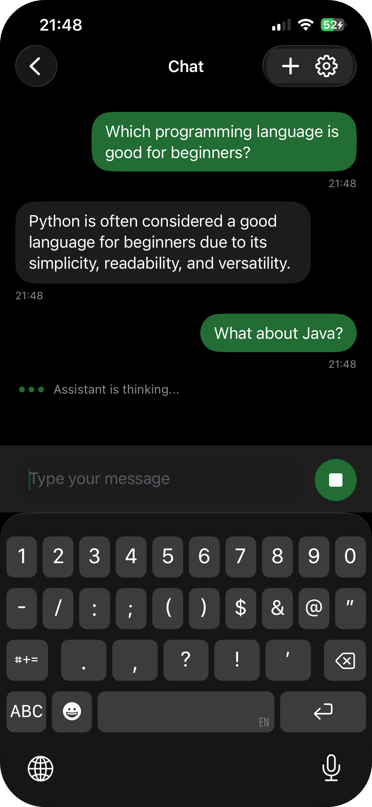
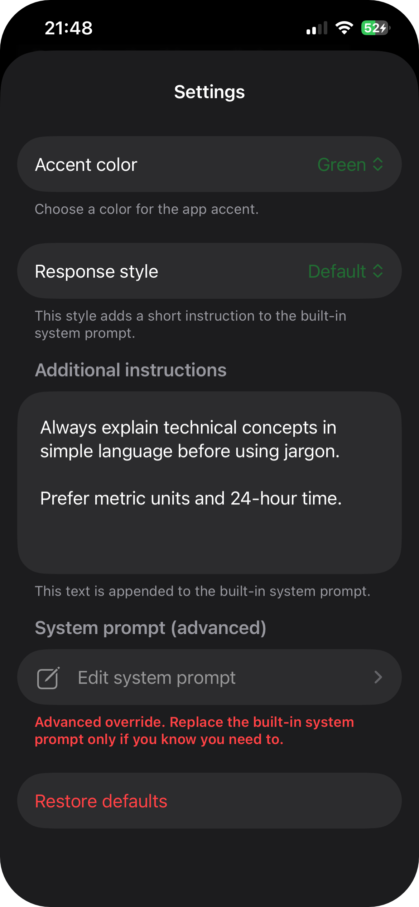
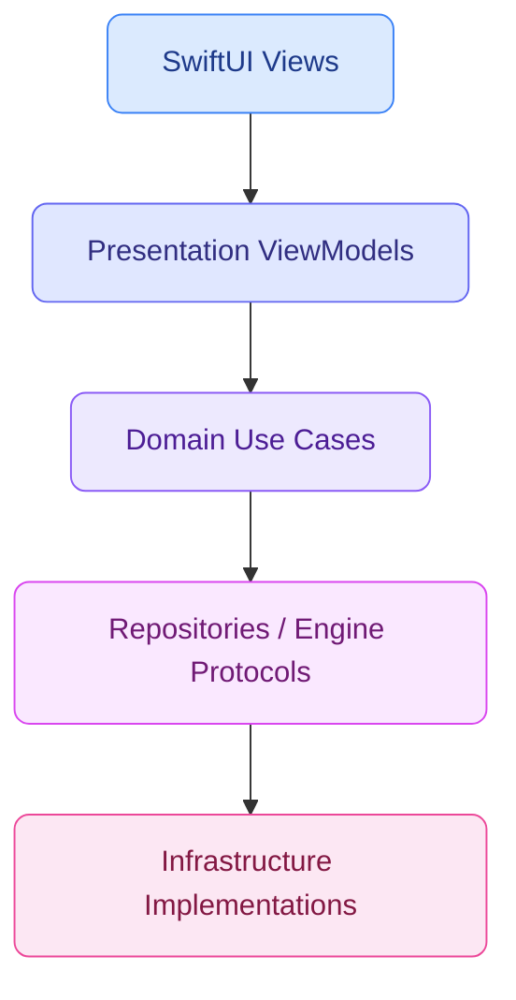

<table>
  <tr>
    <td valign="middle"></td>
    <td valign="middle"><h1>Swift AI Reference App</h1></td>
  </tr>
</table>

A Swift and SwiftUI iOS LLM-chat app built as a clean-code reference implementation: clearly layered, and designed to be easily extended with new models, backends, or features.

## Screenshots

<table width="100%">
  <tr>
    <td align="center" width="33%"></td>
    <td align="center" width="33%"></td>
    <td align="center" width="33%"></td>
  </tr>
</table>

## Feature Overview

| Area | What is in the app |
| --- | --- |
| Model backends | Stub model for simulator/testing. Llama.cpp GGUF inference for real usage. Designed to make adding new models or backends easy |
| Repositories | SQLite and file-backed conversation/message repositories; swappable and easy to extend|
| Chat | Streaming assistant replies, stop generation, and conflict handling when another chat is already generating |
| Conversations | Create, search, rename, delete, sorted by last activity, with continuous title generation |
| Settings | Accent color, custom instructions, response style presets, and system prompt override |
| Localization | Centralized L10n namespace with strings organized into per-language `.lproj` folders. Adding a language is as simple as a new folder. Currently supports English, Czech, and Slovak |

## Architecture



- **SwiftUI Views**: render state and forward user actions to the ViewModel.
- **Presentation ViewModels**: manage UI state, navigation, and user-action flow between views and domain use cases.
- **Domain Use Cases**: models, use cases, and typed errors.
- **Repositories / Engine Protocols**: define the contracts between domain logic and infrastructure. The `LLMEngine` protocol keeps room for future model providers, and repositories keep conversation and message storage swappable.
- **Infrastructure Implementations**: concrete adapters for persistence, prompt settings, prompt formatting, model execution, and title generation.

## Runtime behavior

- Storage defaults to SQLite.
- Set `SWIFTAIREFERENCEAPP_STORAGE_BACKEND` (environment variable) to `file` or `filebacked` to use file-backed storage.
- Set `SWIFTAIREFERENCEAPP_STORAGE_ROOT` (environment variable) to `/path/to/dir` to move the SQLite database or file-backed data into a custom directory.
- A build step copies a `.gguf` file found in the project into the app bundle as `model.gguf`, if one exists.
- If no model is found or loading fails, the app falls back to the stub engine and shows a warning banner.
- Simulator and test runs use `StubLLMEngine`.

## Requirements

- a Mac running macOS Sequoia 15.6 or later with Xcode 26.2 or later (includes the iOS 26.2 SDK and Simulator)

## Getting Started

1. Clone the repo.
2. Run `open SwiftAIReferenceApp.xcodeproj` from the project root.
3. You can now build and run the app in the Simulator, it will use `StubLLMEngine`. To use an actual LLM, complete the steps below as well.
4. Set your Team under Signing & Capabilities to enable running the app on physical devices.
5. Get a llama.cpp-compatible GGUF model file (ChatML or Llama-3 prompt format) and place it in the project root to enable on-device inference. For example, a good small model (works well on M1 Macs) is `Llama-3.2-1B-Instruct-Q8_0.gguf`, which you can download from [bartowski's Hugging Face repo](https://huggingface.co/bartowski/Llama-3.2-1B-Instruct-GGUF/tree/main).
6. Build and run the app with the Run Destination set to a physical iOS device, or to `My Mac (Designed for iPad)` on your Mac. The Mac option is a particularly convenient run destination.

## Testing

Unit tests cover pretty much everything (domain models and use cases, persistence, prompt settings, presentation logic, and llama.cpp formatting and engine behavior).

UI tests cover the launch flow and basic end-to-end flows such as sending a message, conversation title generation, and conversation persistence.

## Project structure

```text
SwiftAIReferenceApp.xcodeproj/
SwiftAIReferenceApp/
  cs.lproj/
  en.lproj/
  sk.lproj/
  App/
  Assets.xcassets/
  Domain/
  Infrastructure/
  Presentation/
SwiftAIReferenceAppTests/
  Domain/
  Infrastructure/
  Presentation/
SwiftAIReferenceAppUITests/
Vendor/
  LlamaBinary/
docs/
<your-model>.gguf  # put your gguf model file here
```

## Credits

The app icon is based on an icon from [Lucide](https://lucide.dev/).

## License

This project is licensed under the MIT License.